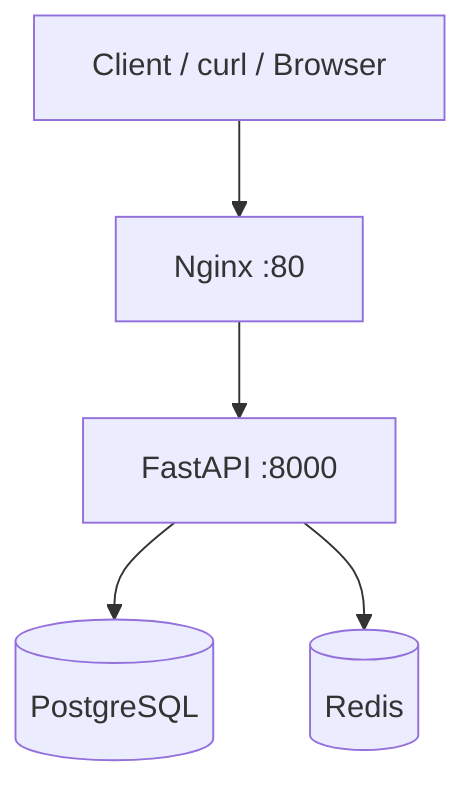

# TaskFlow Platform — Architecture

## System Overview

TaskFlow is a containerized task management API designed as a learning capstone and future production scaffold.

## Component Diagram

## Network

All services run on the default Compose bridge network `taskflow_default`.

| Service | Hostname | Internal Port | Host Exposed |
|---------|----------|---------------|--------------|
| nginx | nginx | 80 | 80 |
| api | api | 8000 | no (via nginx only) |
| db | db | 5432 | no |
| redis | redis | 6379 | no |

## Data Flow

1. Client hits `http://localhost/api/tasks`
2. Nginx proxies to `http://api:8000/api/tasks`
3. API checks Redis cache for stats; queries Postgres for tasks
4. Response returned through Nginx

## Persistence

- PostgreSQL data: named volume `pgdata`
- Redis: ephemeral (cache only — acceptable for MVP)

## Security Decisions

- API runs as non-root user `appuser`
- Database not exposed to host
- Secrets via `.env` file, not baked into images
- Nginx handles TLS termination in production (Week 9)

## Future (Week 2+)

- Terraform: ECS Fargate, RDS, ElastiCache
- GitHub Actions: CI/CD pipeline
- Frontend: Next.js dashboard (Week 5)
